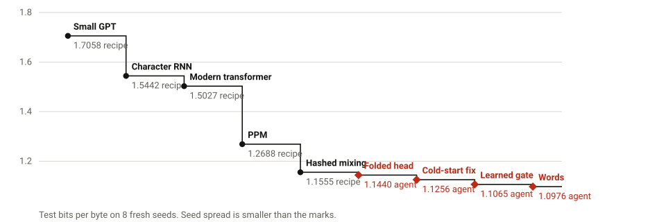
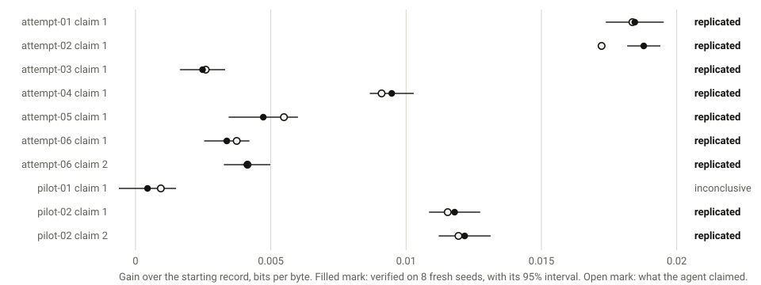
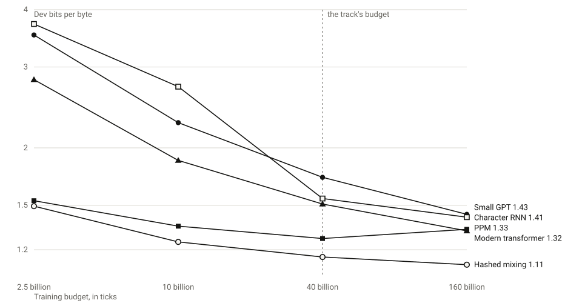

# odometer

A speedrun for training a small language model, with a meter where the clock would be.

<!-- quick -->
**From a clean clone to a verified result in ? seconds on a 2-core runner ([log](https://github.com/abhaymettu/odometer)).** The current record scores 1.0976 bits per byte, and the last four rows of the table are Claude Code agents.
<!-- /quick -->

Every tensor operation costs ticks, priced from its shape alone. An entry gets 40 billion ticks to train a byte-level model on TinyStories, and its score is held-out bits per byte. A laptop and a server run the same program to the same reading and the same score, so hardware only buys finishing sooner. A record has to survive a rerun on fresh seeds by a verifier you can read in one sitting, and coding agents sit on the same table as everyone else.

**[Run the record in your browser](https://abhaymettu.com/odometer/)**. It takes about half a minute, and the page shows your device stopping at the same tick as every other.

## Try it

You need Python 3.12 or newer.

```bash
git clone https://github.com/abhaymettu/odometer && cd odometer
python3 -m venv .venv && .venv/bin/pip install numpy==2.5.4
.venv/bin/python reproduce.py
```

That downloads the data, checks it against fixed hashes, reruns the current record on 2 fresh seeds on the sealed split, and prints your number beside the stored one. Every other headline number has its own command:

| Number | Command |
|---|---|
| The whole table, 8 fresh seeds per record | `python reproduce.py table` |
| Every adversarial entry gets rejected or priced out | `python reproduce.py attacks` (needs `pytest`) |
| The agent series, from the stored claim logs | `python reproduce.py series` |
| Scores across machines | `python tools/fairness.py study/fairness/logs/*.json` |
| What each op really costs on your machine | `python tools/calibrate.py` |
| Budget sweep | `python tools/sweep.py records/09-mixer-words/train.py --out sweep.json` |

## The table

<!-- records -->
|  | Record | Test bits per byte | From |
|---|---|---|---|
| 9 | [Mixing, words and story boundaries](records/09-mixer-words) | 1.0976 ± 0.0014 | Claude Opus 5.5, attempt-04 of the series |
| 8 | [Mixing, learned in-window gate](records/08-mixer-gate) | 1.1065 ± 0.0007 | Claude Opus 5.5, attempt-02 of the series |
| 7 | [Mixing, cold-start fix](records/07-mixer-cold) | 1.1256 ± 0.0007 | Claude Opus 5.5, attempt-01 of the series |
| 6 | [Mixing, folded head, lazy tables](records/06-mixer-fold) | 1.1440 ± 0.0012 | Claude Opus 5.5, in a pilot before the series |
| 5 | [Hashed context mixing](records/05-mixer) | 1.1555 ± 0.0010 | Recipe after Mahoney's PAQ and Knoll's cmix, ported and tuned here |
| 4 | [PPM with learned backoff](records/04-ppm) | 1.2688 ± 0.0003 | Recipe after Cleary and Witten's PPM, ported and tuned here |
| 3 | [Modern transformer](records/03-modern) | 1.5027 ± 0.0070 | Recipe from recent small-model practice, ported and tuned here |
| 2 | [Character RNN](records/02-rnn) | 1.5442 ± 0.0130 | Recipe after Karpathy's char-rnn, ported and tuned here |
| 1 | [Small GPT](records/01-gpt) | 1.7058 ± 0.0106 | Recipe after Karpathy's nanoGPT, ported and tuned here |
<!-- /records -->

Test bits per byte on 8 fresh seeds that decided nothing else. The first five are recipes: each one ported from its authors and tuned on the dev split with a coding agent, and the log of all that tuning is in [entries/TUNING.md](entries/TUNING.md). No person ran them on this track, so read them as baselines and not as human records. Everything after them came from an agent. The sixth came from a pilot before the registered series, and the others from the series itself.

A new record has to beat the holder by more than 0.002 bits per byte at p < 0.01 on 8 fresh seeds, do it again on 8 new seeds, and then get a written review that explains why the gain is real. Each `records/<name>/` holds the code, every seed's log, and that review.

## Why a meter

Speedruns time you, so they measure the hardware along with the idea, and a result from one machine means little on another. Pricing by FLOPs doesn't fix it: BLAS runs about a hundred times more FLOPs per second than `exp`, so an entry heavy on elementwise work would take a hundred times longer for the same reading, and an agent would find that gap fast.

So the price list in [`odometer/_engine.py`](odometer/_engine.py) tracks time instead. A tick is about one nanosecond of one laptop core, and it's a pure function of tensor shapes, so the same program reaches the same reading anywhere. [`tools/calibrate.py`](tools/calibrate.py) measures every op against its price and reports any that drift more than 5x from the median. On a 2-core CI runner one seed takes between about 40 seconds and three minutes, depending on the entry.

## What a rerun guarantees

[`verify.py`](verify.py) is the referee, and it's short enough to read. Its docstring lists each guarantee.

- Training runs in its own process that never loads held-out bytes. Scoring runs in a second, fresh process.
- An entry can import only `odometer` and `math`, and it can name only the engine's public API.
- Python work outside the engine is counted, so it can't stand in for metered compute. Literals and syntax nodes are rationed, so a table can't ride in the source.
- `forward()` sees held-out inputs and never targets, gets fresh parameters on every call, and has its compute per byte capped.
- A quarter of the scored windows have a twin that shares a prefix and differs after a random cut. If the logits before the cut move, the entry was looking ahead or across rows, and the run is void.

## Beat the record

Write one Python file with `train(data)` and `forward(params, x)`. [`entries/`](entries) has five worked examples, and [SUBMITTING.md](SUBMITTING.md) has the steps.

```bash
python verify.py entries/mine/train.py --smoke                 # seconds, to check that it runs
python verify.py entries/mine/train.py --split dev --seeds 8   # tune on this
python verify.py entries/mine/train.py --against records/current.json
```

## Agents on the same table

<!-- agents -->
4 fresh Claude Code sessions ran one after another, each with Opus 5.5 at high effort, 40 minutes on a 4-core VM, and the current record to start from. The test split was zeroed in each agent's copy of the data, so a claim first met test data in the rerun, in a separate CI job, after the session had ended.

4 of 4 claims held up on 8 fresh seeds (Wilson 95% interval 0.51 to 1.00), and 3 became records. The registered plan predicted that claimed gains would shrink, and they did not: the median verified gain was 1.02 times the claimed one. That is a small sample with gains far above seed noise, so it may not hold nearer the noise.



| Attempt | Started from | Claimed gain | Verified gain, 95% | Outcome | Record |
|---|---|---|---|---|---|
| 01 | 06-mixer-fold | 0.0184 | 0.0185 ± 0.0011 | replicated | yes |
| 02 | 07-mixer-cold | 0.0172 | 0.0188 ± 0.0006 | replicated | yes |
| 03 | 08-mixer-gate | 0.0026 | 0.0025 ± 0.0008 | replicated | no |
| 04 | 08-mixer-gate | 0.0091 | 0.0095 ± 0.0008 | replicated | yes |

Each record also needs a written review from a fresh Claude session that reads the code and logs and has to say what buys the gain: `records/<name>/review.md`. Most of these gains are tied to this track, and the reviews say where. As a check on the pipeline, each starting record went through it unchanged, 8 times over: 0 false positives in 16 runs across 2 records, which catches a broken pipeline and nothing finer. The sessions cost $2.21 to $4.49 each at list price.
<!-- /agents -->

The plan, the count and the classification rule were committed before the first counted attempt: [study/PREREG.md](study/PREREG.md). Each agent's whole session is in `study/attempts/<id>/`.

## Same program, same reading

<!-- fair -->
Ticks are a pure function of the program, so they have to match exactly. Scores pass through each machine's BLAS, so they can differ in the last digits. Same seeds of `?`, each machine against ?:

| Machine | Same seeds | Ticks identical | Largest difference, bits per byte | Paired TOST p |
|---|---|---|---|---|

The largest difference is ? bits per byte, about ? times below the record margin of 0.002, and a paired equivalence test against a tolerance of ? passes on every machine. Rerun the comparison with `python tools/fairness.py study/fairness/logs/*.json`, or run the matrix yourself with [the fairness workflow](.github/workflows/fairness.yml). In a browser the demo reads the same tick as native code.
<!-- /fair -->

## What each tick buys



Recipes keep the settings they were tuned with at 40 billion ticks, so this is a floor on what each could do at another budget. Hashed context mixing stays lowest at every budget I ran. The small GPT and the modern transformer keep falling, and the modern transformer passes PPM somewhere past the track's budget. PPM gets worse at 160 billion. It has read the 64 MiB file about six times by then, and I suspect its counts grow overconfident, but I did not test that.

## How a cheat dies

[`tests/attacks/`](tests/attacks) holds 79 entries written to cheat: reading held-out bytes, looking ahead, keeping state between calls, getting compute for free, shipping data in the source, and breaking the verifier. [`tests/test_attacks.py`](tests/test_attacks.py) pins the exact way each one fails, and [the attacks README](tests/attacks/README.md) names each hole the suite found, with its fix.

Four still work, and the tests pin those too, so a change in either direction shows up:

- `open_c_level_sum`: `sum(range(n))` is one counted line, so only the wall limit stops it.
- `open_bigint_vector`: Python big integers do vector arithmetic with almost no ticks.
- `open_long_line`: a line with 2000 additions counts once.
- `open_below_tolerance`: a look-ahead bonus just under the twin tolerance passes, for under 1.5e-4 bits per byte, 13 times below the record margin.

The first three are free compute, but `item()` rations training bytes to 20,000 reads, so free compute has almost nothing to learn from. That this removes any score gain is my inference. I did not measure it.

## What it does not do

- It has no memory or disk cap. The PPM recipe peaks near 1.2 GB.
- Twin values on x86 have reached 2.1e-5 from float noise alone, against a tolerance of 1e-4, so the look-ahead check has about a factor of five to spare on honest entries.
- The seal on the test split stops accidents. TinyStories is public, so a determined entrant could rebuild the split. The static rules limit what that buys. During tuning, two smoke runs on one machine read 32 test windows by accident, and [the tuning log](entries/TUNING.md) records them.
- Prices are close to time, not equal to it. On x86, 331 of 335 calibration rows sit within 5x of the median. A copying `reshape` and its backward run about 7x over their price, so an entry can spend more wall time than its ticks suggest, though copying teaches a model nothing. Squaring and `embedding` run about 6x to 7x under theirs. I froze the prices once records stood on them, so `tools/calibrate.py` exits nonzero on x86 and reads as a failed job in CI.
- The score is one corpus and one budget. A 100-byte alphabet that helps here would cost dearly on anything else.
- The record rule has limited power: 8 seeds against 8 passes a true gain of one seed SD only 31% of the time. Most claims near the noise come back inconclusive, not false.

## Prior work

The single `train.py` and the bits-per-byte framing come from [karpathy/autoresearch](https://github.com/karpathy/autoresearch), whose README notes its wall-clock results aren't comparable across compute platforms. [modded-nanogpt](https://github.com/KellerJordan/modded-nanogpt) and OpenAI's Parameter Golf set the pattern of statistical record rules, and Prime Intellect's verifier reruns 8 seeds. Survival of agent claims has been measured before too, by "Separating Real Improvements from Lucky Runs in Autonomous ML Research" and, for prompts, "Winner's Curse in LLM Self-Improvement Loops". What I couldn't find anywhere is a training budget that's metered per operation and independent of hardware, so that's the part to judge this on. The full check is in [review/novelty-and-exploits.md](review/novelty-and-exploits.md).

Recipes credit their authors in each file: nanoGPT (Karpathy), char-rnn (Karpathy) and GRU (Cho et al.), modded-nanogpt (Jordan et al.), PPM (Cleary and Witten; Moffat), PAQ and lpaq (Mahoney), cmix (Knoll). Data: TinyStories (Eldan and Li, 2023), CDLA-Sharing-1.0.

## Layout

```
verify.py          the referee
odometer/          the metered engine and data access
entries/           the recipes as tuned, and the tuning log
records/           every record: code, seed logs, review, verdict
tests/attacks/     entries written to cheat
study/             the agent series: plan, harness, every attempt's session and claims
tools/             calibration, budget sweep, fairness, figures, page build
docs/              the page, and the in-browser demo
```

MIT licence. The data keeps its own.
